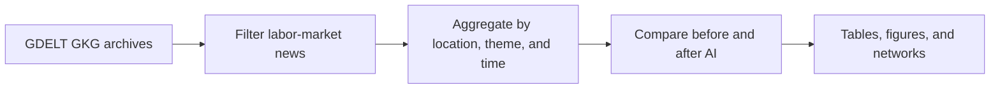

# AI Anxiety Map

The AI Anxiety Map project studies how labor-market discourse changed around
the widespread adoption of generative AI. It processes GDELT Global Knowledge
Graph (GKG) data, measures anxiety- and opportunity-related language, and
compares locations before and after an AI cutoff date.

The current implementation provides:

- a restartable GDELT GKG collection and aggregation pipeline;
- global and selected-location before/after comparisons;
- location–emotion bipartite networks;
- projected location-similarity networks; and
- weighted networks showing changes between the two periods.

## Paper

The project findings, methodology, and limitations are presented in the [AI Anxiety Map paper](paper/latex/main.pdf).  
The LaTeX source is available in [`paper/latex/main.tex`](paper/latex/main.tex).

## Research questions

1. How do different communities perceive the labor market?
2. How do different communities perceive the impact of AI on employment?
3. How similar or polarized are labor-market perceptions across communities
   before and after the rise of generative AI?

## Pipeline



The project has two maintained stages:

1. `1_load_gdelt_data` downloads 15-minute GKG archives, keeps records whose
   `V2Themes` contain a configured labor-market term, and aggregates the
   extracted interactions.
2. `2_ai_anxiety_map` combines the aggregate files, assigns rows to the
   before- or after-AI period, computes feeling scores, and produces the
   comparisons and networks.

The `.py` files use Jupytext's percent format and are paired with executable
`.ipynb` notebooks, combining AI readability with human readability..

## Repository structure

```text
Project/
├── README.md
├── GDELT-Global_Knowledge_Graph_Codebook-V2.1.pdf
├── final_course_project_instructions_2026.pdf
├── paper/
│   └── latex/
│       ├── main.pdf              # compiled paper
│       ├── main.tex              # paper source
│       └── references.bib
├── config/
│   ├── conda_requirements.yml
│   ├── 1_run_load_gdelt_data.sbatch
│   ├── 2_ai_anxiety_map.sbatch
│   └── slurm_commends.md
├── src/
│   ├── 1_load_gdelt_data.py
│   ├── 1_load_gdelt_data.ipynb
│   ├── 2_ai_anxiety_map.py
│   ├── 2_ai_anxiety_map.ipynb
├── data/                         # generated input and intermediate data
│   ├── raw/
│   │   └── temporary_archives/
│   ├── mid_save/
│   └── aggregated/
└── results/                      # generated analysis tables and figures
```

The contents of `data/`, `logs/`, and `results/` are runtime
artifacts and may not exist in a fresh checkout.

## Data source and filtering

The project uses [GDELT 2.1](https://www.gdeltproject.org/) GKG archives from
both the main and translated streams. The loader caches GDELT's two master file
lists in `data/raw/`, but downloaded archive ZIP files are temporary and are
deleted immediately after parsing.

Labor-market records are selected by matching terms in `V2Themes`, including
employment, unemployment, jobs, labor, work, hiring, layoffs, wages, income,
careers, strikes, unions, gig work, and freelance work. The exact list is
defined by `LABOR_THEME_TERMS` in `src/1_load_gdelt_data.py`.

For each matching GKG record, the loader extracts:

- the record ID and GDELT timestamp;
- every matching labor-market theme;
- every `V2Locations` entry, or an `UNKNOWN` location when none is available;
- all seven `V2Tone` values;
- selected GCAM anger, anxiety, uncertainty, fear, hope, optimism, and overall
  feeling dimensions; and
- the dominant available feeling family.

One GKG record can therefore create several interactions: one for every
location–matching-theme combination. The pipeline stores aggregates, not full
article text or article-level records.

## Aggregated data schema

Each final Parquet row represents one combination of:

- `location_type`
- `location_name`
- `location_country_code`
- `location_admin1_code`
- `start_date`
- `end_date`
- `theme`

The remaining columns contain:

| Column group | Contents |
|---|---|
| Volume | unique `article_count` and expanded `interaction_count` |
| Coordinates | mean latitude and longitude |
| GDELT tone | mean tone, positive, negative, polarity, activity density, self/group density, and word count |
| GCAM feelings | mean selected LIWC, Lexicoder, and WordNet dimensions |
| Dominant feelings | counts for anger, anxiety, fear, hope, optimism, uncertainty, and unknown |

Final data is written to:

```text
data/aggregated/gdelt_<START>_<END>_<PERIOD>.parquet
data/aggregated/gdelt_<START>_<END>_<PERIOD>.metadata.json
data/aggregated/gdelt_<START>_<END>_<PERIOD>.png
```

The metadata JSON records the query signature, schema version, archive and
interaction counts, failures, byte counts, and the associated archive-summary
path. The analysis accepts both the current `gdelt_*.parquet` names and legacy
`gdelt_location_theme_*.parquet` names.

## Analysis

### Date settings

| Period | Date range |
|---|---|
| Before generative AI | 2021-01-01 through 2022-12-31 |
| After generative AI | 2023-01-01 through 2024-12-31 |

Rows whose aggregation-window `start_date` is earlier than `AI_CUTOFF` are
classified as `before_ai`; all other rows are classified as `after_ai`.
Change these three constants before a production analysis.

### Feeling scores

The current analysis derives three row-level measures:

```text
mean anxiety score =
    mean(LIWC anxiety, WordNet anxiety, WordNet fear, Lexicoder uncertainty)

mean opportunity score =
    mean(WordNet hope, WordNet optimism)

mean feeling score =
    mean anxiety score - mean opportunity score
```

A higher `mean_feeling_score` therefore means that the selected anxiety
dimensions outweigh the selected opportunity dimensions. These are unweighted
means of the aggregate rows; article and interaction counts are summarized
separately.

### Comparisons and networks

The analysis produces:

- global article volume, location count, and mean-score comparisons;
- per-location comparisons for the configured selectors.
- a location–emotion bipartite graph for each period.
- a location-only projection for each period.
- pairwise location-similarity scores and percentage changes.
- Combined, direction-specific, and feeling-group-specific difference
  networks.

For network construction, the code currently retains up to 20 countries per
period with at least 50 interactions. The bipartite visualizations show up to
120 of the strongest positive location–emotion edges.

Pairwise location similarity is:

```text
similarity(A, B) = Σ min(weight(A, feeling), weight(B, feeling))
```

The sum is taken over feeling dimensions shared by both locations. Percentage
changes compare location pairs present in both periods, using the before-AI
score as the baseline. Difference-network edge weights are the after-AI
location–emotion weights minus their before-AI values.

## Environment setup

From the repository root:

```bash
conda env create -f Project/config/conda_requirements.yml
conda activate ai_map_env
python -m ipykernel install --user \
    --name ai_map_env \
    --display-name "ai_map_env"
```

The environment uses Python 3.11 and includes pandas, PyArrow, Matplotlib,
Seaborn, Plotly, NetworkX, Requests, pycountry, Jupytext, Papermill, and tqdm.
Exact versions are pinned in `config/conda_requirements.yml`.

To update an existing environment:

```bash
conda env update \
    -n ai_map_env \
    -f Project/config/conda_requirements.yml \
    --prune
```

## Running the project

Run commands from the repository root or the `Project` directory. Both scripts
locate the project from common launch locations.

### 1. Collect and aggregate GDELT data

The loader supports these environment variables:

| Variable | Source-code default | Meaning |
|---|---:|---|
| `GDELT_DATE_START` | `2023-01-01` | inclusive first archive date |
| `GDELT_DATE_END` | `2023-03-01` | inclusive last archive date |
| `GDELT_AGGREGATION_PERIOD` | `7D` | pandas offset used for output windows |
| `GDELT_SAVE_INTERVAL` | `1M` | checkpoint interval |
| `GDELT_JOB_ID` | Slurm job ID or `local` | filesystem-safe run identifier |


The default two-month download can take several days. For a quick check, use a
small date range:

```bash
cd Project

export GDELT_DATE_START="2023-01-01"
export GDELT_DATE_END="2023-01-02"
export GDELT_AGGREGATION_PERIOD="7D"
export GDELT_SAVE_INTERVAL="1W"
export GDELT_JOB_ID="local_smoke_test"

conda run -n ai_map_env python src/1_load_gdelt_data.py
```

The loader:

- uses up to eight worker processes, bounded by available CPUs and
  `SLURM_CPUS_PER_TASK`.
- Retries failed downloads up to eight times/
- Records archive failures and continues processing.
- Writes progress reports and resumable checkpoint pairs to `data/mid_save/`.
- Uses an output lock to prevent duplicate concurrent work.
- Reuses a complete output when its metadata query signature matches.
- Can resume from the newest compatible checkpoint, including a checkpoint
  created by another job ID whose date range is contained in the current
  query.

### 2. Run the analysis

Confirm the study dates and location selectors near the top of
`src/2_ai_anxiety_map.py`, then run:

```bash
cd Project
conda run -n ai_map_env python src/2_ai_anxiety_map.py
```

The script loads every `data/aggregated/gdelt_*.parquet` file whose date filter
matches the study interval. Analysis outputs are stored under a date-specific
directory:

```text
results/start_<START>_cutoff_<CUTOFF>_end_<END>/
```

Tables are exported in both CSV and LaTeX formats. Figures are saved as PNG
files and displayed during interactive execution. Main output groups include:

- `period_summary*` and `global_comparison*`;
- `per_location_*`;
- `location_emotion_bipartite_*`; and
- `location_similarity_*`.

## Running on the BGU Slurm cluster

Submit one loader job:

```bash
cd "/home/${USER}/Data-Mining-Assignments/Project"

export GDELT_DATE_START="2024-01-01"
export GDELT_DATE_END="2024-03-01"
export GDELT_AGGREGATION_PERIOD="7D"
export GDELT_SAVE_INTERVAL="1W"

sbatch --export=ALL config/1_run_load_gdelt_data.sbatch
```

Submit the analysis after the required aggregates are complete:

```bash
cd "/home/${USER}/Data-Mining-Assignments/Project"
sbatch config/2_ai_anxiety_map.sbatch
```

The batch scripts execute the paired notebooks with Papermill and save the
executed notebooks plus standard output/error files in `logs/`. Example
multi-job submission commands and interactive-job notes are available in
`config/slurm_commends.md`.

## Syncing Jupytext notebooks

After modifying either maintained `.py` file, sync its notebook from the
repository root:

```bash
conda run -n ai_map_env jupytext --sync Project/src/1_load_gdelt_data.py
conda run -n ai_map_env jupytext --sync Project/src/2_ai_anxiety_map.py
```

## Reference files

- `GDELT-Global_Knowledge_Graph_Codebook-V2.1.pdf` documents the GKG fields and
  GCAM dimensions used by the loader.
